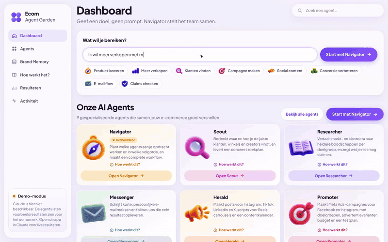
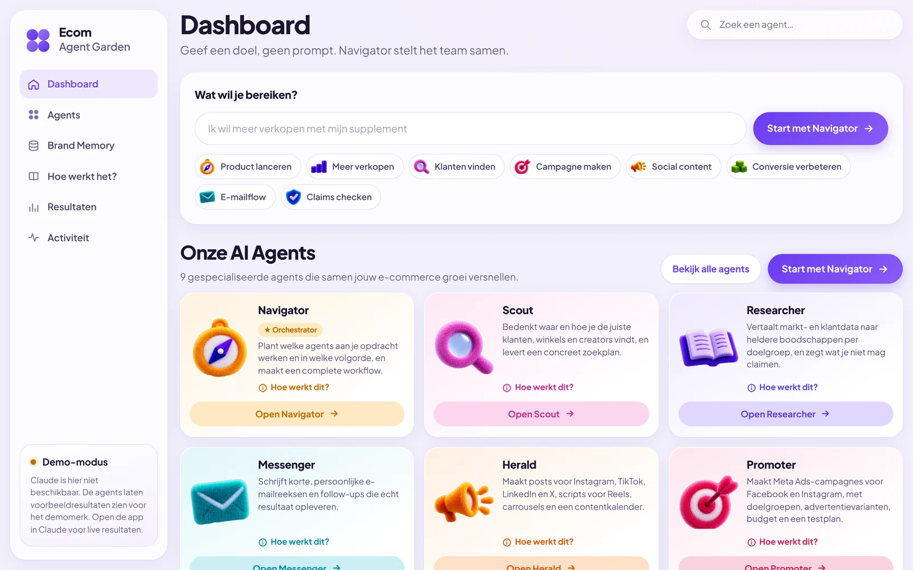
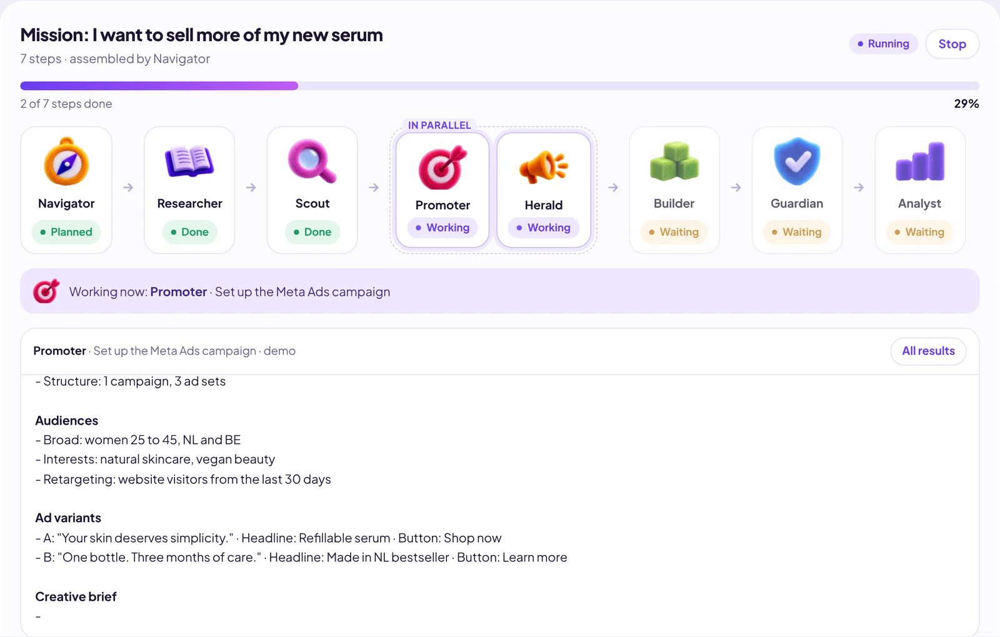
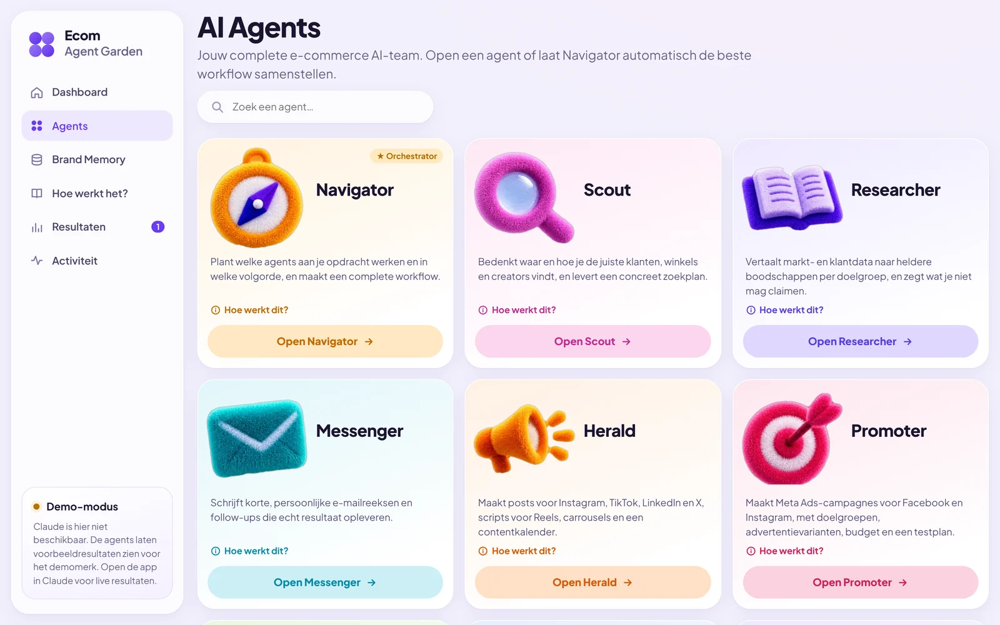
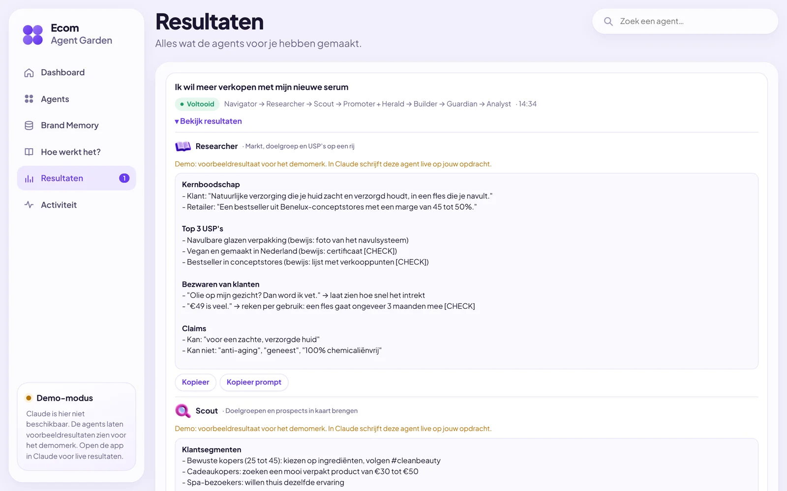
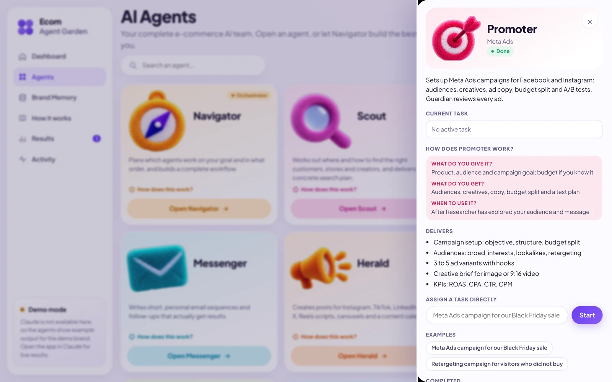
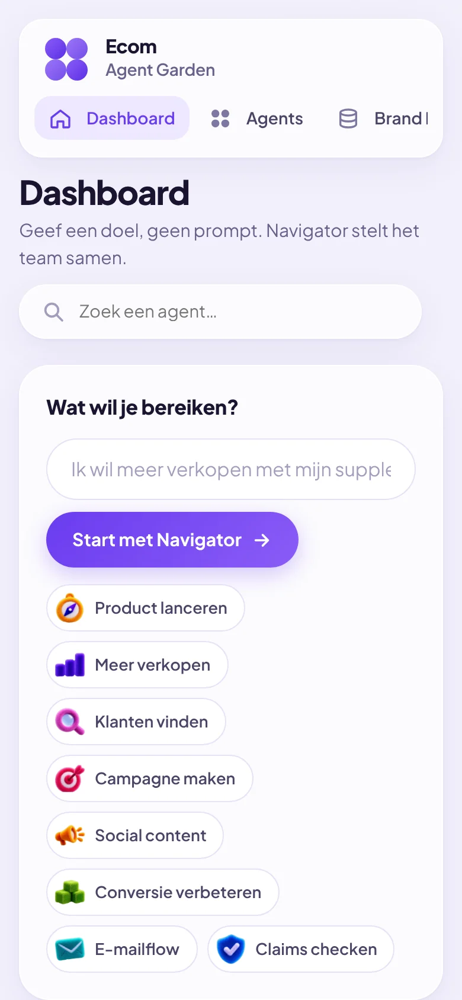

# Ecom Agent Garden

**Give it a goal, not a prompt.** Ecom Agent Garden is an AI team of nine agents for e-commerce brands. You describe what you want to achieve, the Navigator assembles a workflow, and the agents research, write, review and measure, in order and partly in parallel.

**Live demo:** https://sylvievvv.github.io/ecom-agent-garden/



**Video walkthrough (54 s):** [media/demo.mp4](media/demo.mp4)

> The interface is in Dutch. Outside Claude the app runs in **demo mode** with example output for a fictional brand; inside Claude it runs live.



## How it works

1. **Pick a goal**: "Ik wil meer verkopen met mijn nieuwe serum" (I want to sell more of my new serum).
2. **Navigator plans the mission**: chooses the agents, the order, and which of them can work at the same time.
3. **Agents do the work**: each one builds on the output of the steps before it.
4. **Guardian reviews**: added automatically before anything that will be published or sent.
5. **Analyst measures**: a report and concrete optimisations, or a measurement plan when there is no data yet.



## The team

| Agent | Role | Delivers |
| --- | --- | --- |
| Navigator | Orchestration | The route: which agents, in what order, in parallel where possible |
| Scout | Prospects and audiences | Customer segments, retailers and creators to target, search plan |
| Researcher | Market and competition | Core message, USPs, objections, which claims are safe |
| Messenger | Email and outreach | Outreach sequences and customer flows |
| Herald | Organic social | TikTok and Reels scripts, carousels, captions, content calendar |
| Promoter | Meta Ads | Campaign structure, audiences, ad variants, budget split, test plan |
| Builder | Pages and sales assets | Landing pages, product pages, newsletters, retailer one-pagers |
| Guardian | Claims and compliance | OK / REVISE / STOP verdict with rewritten lines (EU consumer law, discount rules, ad policies) |
| Analyst | Data and optimisation | KPI report (ROAS, CPA, AOV, conversion) and next steps |



## Features

- **Goal-based orchestration.** The Navigator turns one sentence into a mission of up to seven steps. Agents that do not depend on each other (for example Promoter and Herald) run at the same time.
- **Automatic compliance gate.** Guardian is inserted after every step that produces public-facing text. You never have to start it yourself.
- **Shared context.** Each agent receives the Brand Memory and the output of earlier steps, and knows which agent it works alongside.
- **Mission view.** Progress bar, step status, "next step" hint and streaming output.
- **Onboarding built in.** A "How it works" page with a mental map, a "try it yourself" box and a first-mission checklist that ticks off what you actually did. Every agent card has a "How does this work?" panel: what to give, what you get, when to use it.
- **Works without a backend.** Results, Brand Memory and activity are stored in the browser.

| Results | Agent details | Mobile |
| --- | --- | --- |
|  |  |  |

## Live mode and demo mode

The app was built as a [Claude](https://claude.ai) artifact. Inside Claude it uses the artifact runtime (`window.claude.use("sample")`) to call Claude for every agent step, streaming the answer into the page. Each run uses the viewer's own Claude usage, and the viewer is asked for permission first.

Outside Claude (for example on GitHub Pages) that runtime does not exist, so the app switches to **demo mode**: the full mission still runs, step by step and in parallel where planned, but each agent shows a pre-written example for the fictional brand *Lumière Botanicals*, clearly labelled as a demo. The real prompt each agent would have used can still be copied.

## Tech

- One `index.html`: HTML, CSS and vanilla JavaScript. No framework and no build step.
- Plush 3D icons as WebP in `assets/icons/`.
- Font: Plus Jakarta Sans via Google Fonts.
- State in `localStorage`, wrapped so the app still works when storage is blocked.
- Tested with Playwright: navigation, search, agent details, full missions (including parallel steps, stop and error handling), demo mode, persistence and mobile layout.

## Run locally

```bash
git clone https://github.com/sylvievvv/ecom-agent-garden.git
cd ecom-agent-garden
python3 -m http.server 8000
# open http://localhost:8000
```

## Project structure

```
index.html          the whole app
assets/icons/       agent icons (WebP)
screenshots/        images used in this README
media/              demo video and GIF
```

## Limitations

- Agents cannot browse the web. Scout delivers a search plan, not a scraped lead list, and agents mark anything they cannot verify with `[CHECK]`.
- Data lives in one browser; there is no account or team sync.
- Guardian flags risks but does not replace legal advice.
- Shopify and ad-platform integrations are not connected yet.

## Credits

Concept and design direction by [@sylvievvv](https://github.com/sylvievvv). Built together with Claude.
